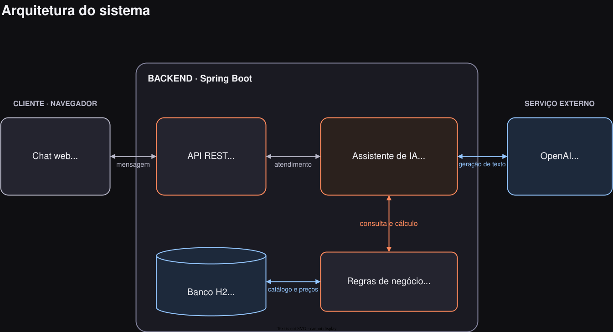

# Brasa's Churrascaria — Assistente Virtual

Projeto de portfólio em Java que integra a API da OpenAI a ferramentas de consulta de cardápios e cálculo de orçamentos. O modelo conduz a conversa; os preços vêm do H2 e os cálculos são feitos no backend com `BigDecimal`.

## Tecnologias

| Tecnologia | Versão | Uso |
|---|---|---|
| Java | 21 | Backend |
| Spring Boot | 3.5.11 | API REST, validação e injeção de dependências |
| Spring Data JPA e H2 | Gerenciadas pelo Spring Boot | Catálogo em banco de dados em memória |
| LangChain4j e integração OpenAI | 1.11.0 | Conversação e chamadas de ferramentas |
| Lombok | Gerenciada pelo Spring Boot | Acessores das entidades |
| Marked / DOMPurify | 18.0.14 / 3.4.16 | Renderização e sanitização do Markdown no chat |

## Como funciona

1. O cliente informa o tipo de churrasco, os convidados e a duração.
2. O assistente consulta os cardápios e solicita as informações que faltam.
3. Quando os dados necessários estiverem completos, as ferramentas Java calculam o churrasco e as bebidas escolhidas.
4. O assistente apresenta os valores retornados pelas ferramentas e o total.

O fluxo conversacional é orientado pelo prompt. O backend valida mensagem, quantidades e duração, independentemente das instruções do modelo.

O assistente é registrado manualmente em um bean Spring com `AiServices.builder()`:

```java
return AiServices.builder(AiAssistantService.class)
        .chatModel(model)
        .chatMemoryProvider(memory)
        .tools(menuTools, budgetTools)
        .build();
```

A interface usa `@SystemMessage`, `@MemoryId` e `@UserMessage`. As ferramentas são métodos anotados com `@Tool`. O projeto utiliza essa configuração explícita, sem o starter de autoconfiguração do LangChain4j.

| Ferramenta | Responsabilidade |
|---|---|
| `menuDrinks` | Consultar cervejas e sucos por categoria no H2 |
| `bbqMenu` | Consultar os itens dos cardápios Premium e Essencial |
| `budgetBBQ` | Calcular churrasco, desconto infantil, horas extras e custo operacional |
| `budgetBeer` | Calcular cervejas com a taxa de 25% |
| `budgetJuice` | Calcular sucos com a taxa de 10% |
| `sumTotalBudget` | Somar os valores já calculados, sem reaplicar taxas |

## Arquitetura




## Organização

```text
src/main/java/com/gstech/AssistantAi/
├── configLLM/       # Modelo OpenAI, memória e registro do assistente
├── controllers/     # Endpoint de chat e tratamento de erros
├── dto/             # Contratos da API e resultados das ferramentas
├── model/           # Entidades do catálogo e enums
├── repositories/    # Consultas JPA
├── service/
    ├── MenuService.java               # Consulta e montagem dos cardápios
    ├── BudgetCalculationService.java  # Cálculos e validação do orçamento
    └── BudgetToolService.java         # Ferramentas de cálculo para a IA
└── tools/
    └── MenuToolsService.java          # Ferramentas de consulta para a IA
```

A interface está em `src/main/resources/static/index.html`. O arquivo `data.sql` popula o catálogo na inicialização.

## Cardápios e regras de negócio

| Categoria | Essencial | Premium |
|---|---|---|
| Bovinos | Picanha, Contra-filé | Picanha Angus, Ancho, Chorizo |
| Suínos | Linguiça toscana | Costela suína, Linguiça defumada |
| Aves | Coração de frango, Coxa e sobrecoxa | Medalhão de frango com bacon, Asinhas de frango |
| Entradas e acompanhamentos | Arroz branco, Farofa, Vinagrete, Maionese, Pão de alho | Queijo coalho, Pão de alho especial, Arroz branco, Farofa especial, Salada verde |

| Regra | Valor |
|---|---|
| Essencial | R$ 59,90 por adulto |
| Premium | R$ 79,90 por adulto |
| Criança menor de 12 anos | 50% do preço de um adulto, sem arredondar o número de convidados |
| Hora extra após 4 horas | Acréscimo de 10% por hora sobre o churrasco |
| Custo operacional | Acréscimo de 15% sobre o churrasco |
| Brahma / Skol, 600 ml | R$ 9,00 por garrafa, antes da taxa |
| Heineken, 600 ml | R$ 12,00 por garrafa, antes da taxa |
| Sucos de laranja, maracujá e abacaxi | R$ 8,00 por litro, antes da taxa |
| Taxa de cervejas / sucos | 25% / 10% |

As quantidades das bebidas são informadas pelo cliente. Marcas ou sabores não escolhidos recebem quantidade zero. Quantidades negativas, duração menor que uma hora e eventos sem convidados são rejeitados.

Exemplo: 1 adulto e 1 criança no Essencial, durante 4 horas, custam `59,90 × 1,5 × 1,15 = R$ 103,33`. O arredondamento monetário ocorre no final, com duas casas decimais e `HALF_UP`.

## Executar

É necessário Java 21 e uma chave da API da OpenAI com acesso ao modelo escolhido. O Maven Wrapper baixa a versão do Maven usada pelo projeto.

Na primeira execução, crie o arquivo de configuração na raiz:

```bash
cp .env.example .env
```

Se o `.env` já existir, edite-o diretamente para preservar sua chave. Preencha as duas variáveis:

```dotenv
OPENAI_API_KEY=
OPENAI_MODEL=
```

Preencha `OPENAI_API_KEY` com sua chave da OpenAI e `OPENAI_MODEL` com o identificador de um modelo compatível com Chat Completions, function calling e `reasoning_effort=none`. A aplicação envia esse nível de raciocínio para permitir o uso de ferramentas com modelos como `gpt-6-luna`. A aplicação exige ambos preenchidos e não escolhe um modelo automaticamente. O token deve ser informado sem o prefixo `Bearer`; a integração adiciona esse cabeçalho. Consulte a [documentação oficial de autenticação](https://developers.openai.com/api/reference/overview) e de [chamadas de ferramentas](https://developers.openai.com/api/docs/guides/function-calling) para conferir a compatibilidade do modelo escolhido.

O Spring carrega o `.env` como arquivo de propriedades a partir do diretório de execução. Use `NOME=valor`, sem `export` nem aspas envolvendo o valor. Variáveis de ambiente do processo também são aceitas. O `.env` é ignorado pelo Git; somente `.env.example` é versionado.

Inicie a aplicação a partir da raiz do projeto:

```bash
./mvnw spring-boot:run
```

No Windows, use `mvnw.cmd spring-boot:run`.

Abra [http://localhost:8080](http://localhost:8080). A interface chama `/api/chat` no mesmo domínio e também funciona quando a aplicação é hospedada em outra porta ou domínio.

O console H2 está em `/h2-console`, com URL JDBC `jdbc:h2:mem:testdb`, usuário `sa` e senha vazia.

## Testes

```bash
./mvnw test
```

Os testes usam o perfil `test`, H2 e um modelo simulado. Não exigem `.env`, chave OpenAI ou chamadas reais à API. Na primeira execução, o Maven precisa de acesso à internet para baixar as dependências.

A suíte cobre cálculo infantil, horas extras, taxas, entradas inválidas, preços ausentes, dados iniciais do H2, consulta de bebidas por categoria, ordenação dos itens do cardápio e uso dos preços armazenados no banco.

Para gerar o pacote:

```bash
./mvnw package
```

## API

### `POST /api/chat`

```json
{
  "userMessage": "Gostaria de um orçamento para 10 adultos e 2 crianças",
  "id": null
}
```

`userMessage` é obrigatório e aceita até 4000 caracteres. O nome antigo `UserMessage` continua aceito para compatibilidade. O `id` é opcional e aceita até 64 caracteres; quando ausente ou vazio, um UUID é gerado. Nas próximas mensagens, envie o `id` retornado para continuar a conversa.

Resposta:

```json
{
  "outputLLM": "Olá! Você prefere o churrasco Premium ou Essencial?",
  "id": "3fa85f64-5717-4562-b3fc-2c963f66afa6"
}
```

Erros retornam um status HTTP e uma mensagem destinada ao usuário:

```json
{
  "message": "O serviço de IA está temporariamente indisponível. Tente novamente em instantes."
}
```

| Status | Situação |
|---|---|
| 400 | Mensagem ou JSON inválido |
| 429 | Limite de uso do provedor atingido |
| 503 | Provedor ou modelo indisponível |
| 504 | Tempo de resposta do provedor excedido |
| 500 | Falha inesperada |

## Limites da demonstração

- O H2 é recriado com os dados iniciais quando a aplicação inicia. Orçamentos não são salvos.
- O histórico de conversa fica na memória da aplicação, com até 30 mensagens por conversa. Reiniciar a aplicação apaga esse histórico.
- A API da OpenAI é um serviço externo e pode apresentar indisponibilidade ou limites de uso. A API e a interface apresentam essas falhas ao usuário.
- O chat sanitiza o HTML gerado pelo Markdown. Se as bibliotecas do CDN não estiverem disponíveis, a resposta aparece como texto.
